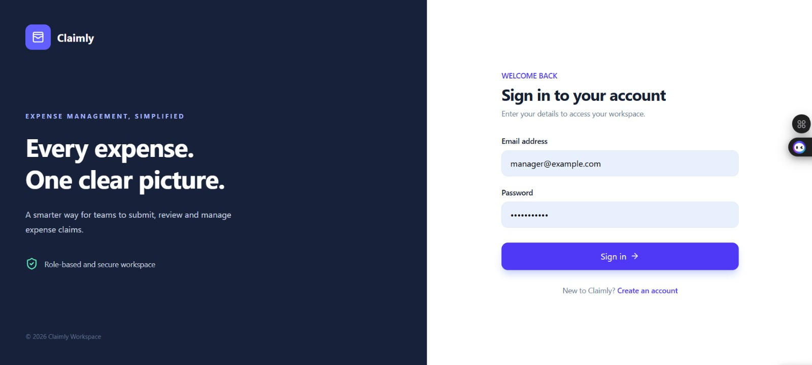
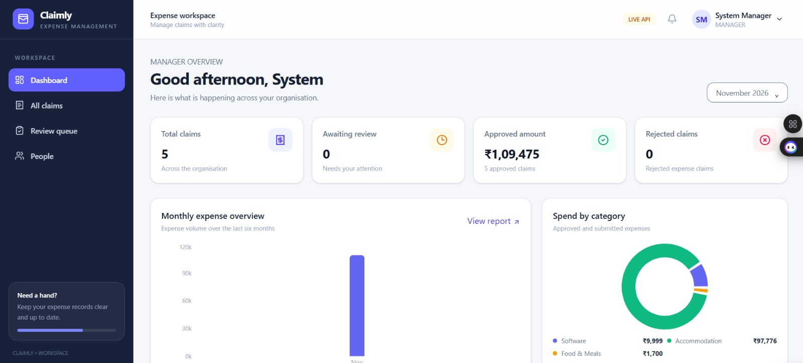
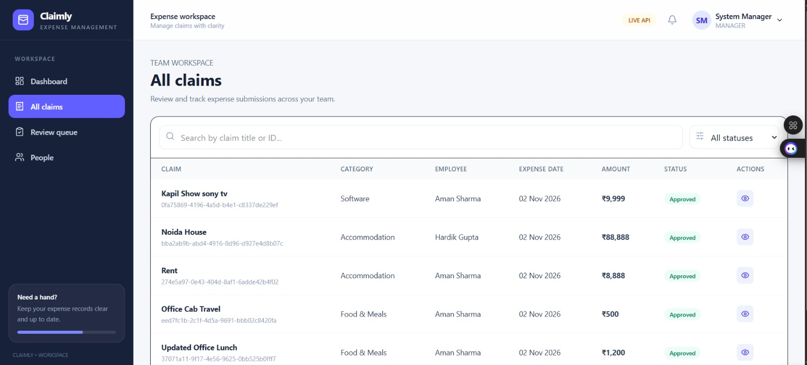
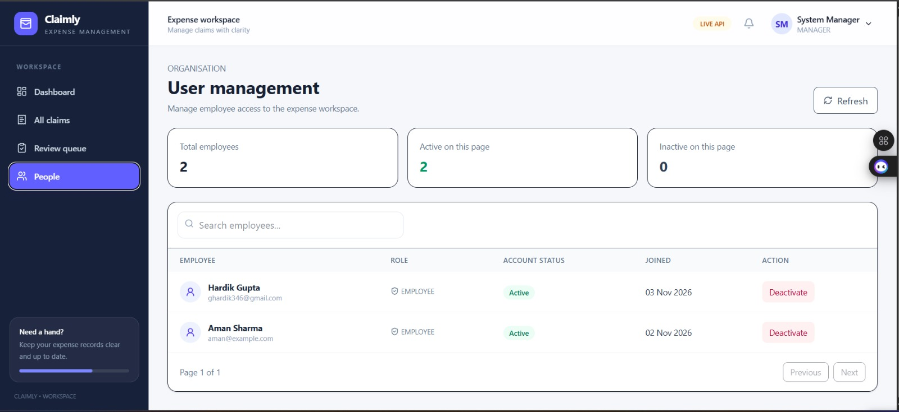
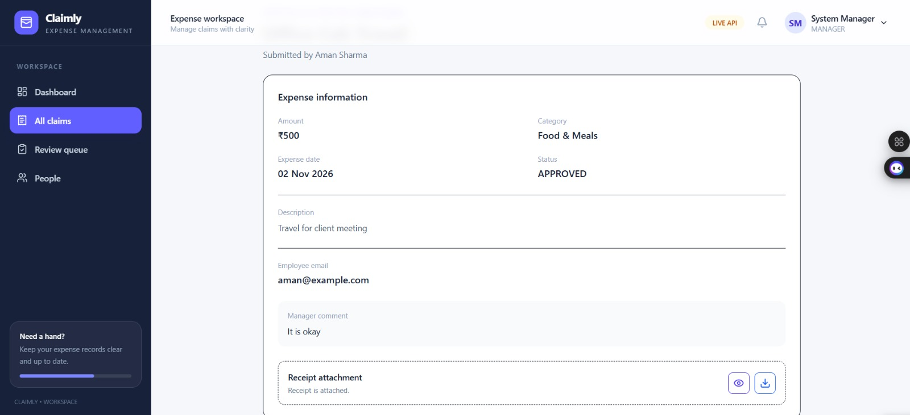

# Application Screenshots

## 1. Employee Portal

The Employee Portal allows employees to create expense claims, manage their own claims, upload receipts, and track claim status.

### Employee Dashboard


### Create Expense Claim


### Employee Claims


### My Claims


---

## 2. Manager Portal

The Manager Portal allows managers to monitor expense claims, review and approve or reject claims, and manage employees.

### Manager Login


### Manager Dashboard


### All Employee Claims


### Employee Management


### Review Claims


### View Claims



# Expense Claim Management System

React + Vite frontend starter with a polished, interactive demo mode and an Axios service layer ready for the Spring Boot API.

## Requirements
- Node.js 20.19+ or 22.12+
- npm

## Setup
```bash
npm install
cp .env.example .env
npm run dev
```
On Windows PowerShell, use `Copy-Item .env.example .env`.

Open the URL printed by Vite (normally http://localhost:5173).


You can switch role from the user menu in the top-right to preview both experiences. Demo mode uses browser local storage and does not call the backend.

## Connect Spring Boot
1. Set `VITE_DEMO_MODE=false` in `.env`.
2. Set `VITE_API_BASE_URL` to your backend base URL, for example `http://localhost:8080/api/v1`.
3. Review `src/services/` endpoint paths against your actual controller mappings before testing live integration.
4. The Axios interceptor attaches the access token and attempts refresh on 401. Confirm the refresh request path and payload against your AuthController.

## Build
```bash
npm run build
npm run preview
```

## Main structure
- `pages/`: route-level screens
- `components/`: shared layout and UI
- `services/`: Axios client and API calls
- `context/`: authentication state
- `routes/`: route definitions and role guards
- `utils/`: formatting helpers


